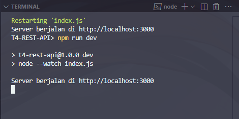

# Tugas 4 - REST API Dasar

## Identitas

- Mata kuliah: Pemrograman Web Lanjut - Kelas B
- Nama: Rakasya Yoga Surya Pratama
- NIM: F1D02310022

## Deskripsi Tugas

Tugas ini merupakan implementasi pembuatan REST API sederhana menggunakan Node.js dan Express untuk menampilkan list film MCU. Topik ini dipilih karena ketertarikan saya suka dengan film film MCU (Marvel Cinematic Univers) dan memiliki atribut yang mudah dipahami, yaitu id, judul, tahun, genre, rating.

## Cara Menjalankan

1. npm install
2. npm run dev
3. Buka http://localhost:3000

## Daftar Endpoint

| Method | URL         | Fungsi                                 | Status          |
| ------ | ----------- | -------------------------------------- | --------------- |
| GET    | `/film`     | Menampilkan semua data film            | 200             |
| GET    | `/film/:id` | Menampilkan detail film berdasarkan ID | 200 / 400 / 404 |
| DELETE | `/film/:id` | Menghapus film berdasarkan ID          | 204 / 400 / 404 |

## Bentuk Data

Contoh satu objek:

```json
  {
    id: 1,
    judul: "Iron Man",
    tahun: 2008,
    genre: "Action",
    rating: 7.9,
  },
```

Penjelasan setiap field:

- `id`: identitas unik untuk mencari film melalui URL.
- `judul`: judul film yang ada dalam list.
- `tahun`: tahun rilis film.
- `genre`: genre film.
- `rating`: rating film sesuai data di internet.

## Pengujian

Gunakan Postman, Thunder Client, Bruno, atau REST Client. Pastikan server sedang berjalan.

### Server Berjalan

Screenshot:


### GET daftar

Screenshot:


### GET detail yang tersedia

Screenshot:


### GET detail yang tidak tersedia

Screenshot:


### DELETE

Screenshot:


### DELETE ID yang tidak ada

Screenshot:


### GET detail yang tidak tersedia

Screenshot:


## Deklarasi Penggunaan AI

| Bagian                    | Alat AI | Dipakai untuk apa                                                                                           | Bagaimana saya memeriksa hasilnya                               |
| ------------------------- | ------- | ----------------------------------------------------------------------------------------------------------- | --------------------------------------------------------------- |
| Data (`src/data/film.js`) | ChatGPT | Membantu mencari contoh 10 objek film sesuai                                                                | saya meastikan rating dan tahun rilis benar, dan menambahkan id |
| Route (`index.js`)        | ChatGPT | Membantu menyusun error handling, memberikan format yang jelas terkait error yang kemungkinan dapat terjadi | Saya memastikan format error sesuai dengan eror nya             |
| README                    | ChatGPT | -                                                                                                           | -                                                               |

Pernyataan: Saya menggunakan ChatGPT pada bagian yang tercantum di tabel. bagian lain saya kerjakan sendiri menggunakan refrensi pada modul panduan yang diberikan.

## Kesimpulan dan Kendala

Dari implementasi tugas ini saya belajar bagaimana cara membuat REST API dengan Express, mulai dari membuat GET sederhana, membaca parameter ID dan mengirimkan sesuai ID, dan menghapus isi data sesuai ID. dan juga saya belajar memberikan error yang benar, dari kode dan pesan agar mudah di pahami oleh pengguna.
