# Tugas 5 - Middleware & Error Terpusat

## Identitas

- Nama: Rakasya Yoga Surya Pratama
- NIM: F1D02310022
- Varian: B — Kantin (`/menu`)

## Cara Menjalankan

1. Pastikan Node.js dan npm sudah terpasang.
2. Jalankan `npm install`.
3. Salin `.env.example` menjadi `.env`.
4. Atur `API_KEY` di `.env` (contoh: `f1d02310022`).
5. Jalankan `npm run dev`.
6. Server aktif di `http://localhost:3000`.

## Struktur Proyek

```text
T5-MIDDLEWARE-ERROR/
├── controllers/       # Mengatur request dan response HTTP
├── data/              # Menyimpan data menu awal
├── middlewares/       # Logger, API key, validasi, notFound, errorHandler
├── routes/            # Definisi endpoint menu
├── services/          # Logika bisnis dan pengolahan data
├── utils/             # Class AppError
├── validators/        # Skema validasi Joi
├── index.js           # Konfigurasi dan pemasangan middleware/router
├── requests.http      # Skenario pengujian REST Client
└── README.md
```

## Endpoint

| Method | URL                      | Middleware                  | Status                      |
| ------ | ------------------------ | --------------------------- | --------------------------- |
| GET    | `/menu`                  | logger                      | 200                         |
| GET    | `/menu?kategori=minuman` | logger                      | 200                         |
| GET    | `/menu/:id`              | logger                      | 200 / 404                   |
| POST   | `/menu`                  | logger, cekApiKey, validate | 201 / 401 / 422 / 409       |
| DELETE | `/menu/:id`              | logger, cekApiKey           | 204 / 401 / 404             |
| PUT    | `/menu/:id`              | logger, cekApiKey, validate | 200 / 401 / 422 / 404 / 409 |

Semua endpoint memakai awalan `/menu` yang dipasang melalui `app.use('/menu', menuRouter)` di `index.js`.

## Aturan Validasi, Aturan Bisnis, dan Kode Error

- `nama`: string, 3–50 karakter, wajib.
- `harga`: bilangan bulat, 1.000–100.000, wajib.
- `kategori`: wajib, salah satu dari `makanan`, `minuman`, `camilan`.
- `tersedia`: boolean, default `true`.
- Nama menu tidak boleh duplikat tanpa membedakan huruf besar/kecil. Pemeriksaan dilakukan di service dan menghasilkan HTTP 409 `NAMA_DUPLIKAT`, karena aturan ini bergantung pada data yang sudah tersimpan, bukan sekadar bentuk input.
- Validasi Joi menggunakan `abortEarly: false`, sehingga semua kesalahan input dikumpulkan dan dikirim dengan HTTP 422 `VALIDATION_ERROR`.

Kode error:
| HTTP | Kode | Keterangan |
|---|---|---|
| 401 | `UNAUTHORIZED` | API key kosong atau salah |
| 404 | `NOT_FOUND` | Data menu tidak ditemukan |
| 404 | `ROUTE_NOT_FOUND` | URL/endpoint tidak dikenal |
| 409 | `NAMA_DUPLIKAT` | Nama menu sudah digunakan |
| 422 | `VALIDATION_ERROR` | Input tidak sesuai skema |
| 500 | `INTERNAL_SERVER_ERROR` | Kesalahan internal server |

Format error konsisten: `{ "error": { "pesan": "...", "kode": "..." } }`. Detail stack error 500 hanya dicatat di terminal, tidak dikirim ke klien.

## Pengujian

Pengujian dilakukan menggunakan Postman untuk memastikan seluruh endpoint berjalan sesuai fungsinya, termasuk pengujian kondisi berhasil maupun kondisi error.

### 1. Pengujian GET

1. GET semua data menu untuk menampilkan seluruh daftar menu yang tersedia.

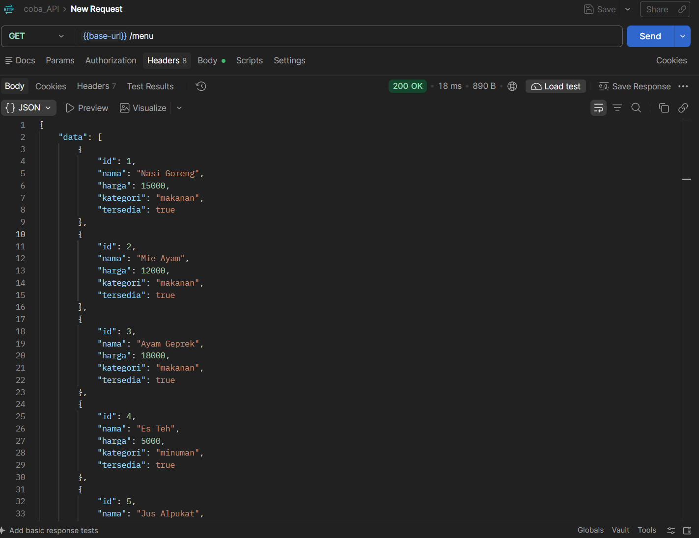

2. GET data menu berdasarkan ID untuk menampilkan detail menu tertentu.

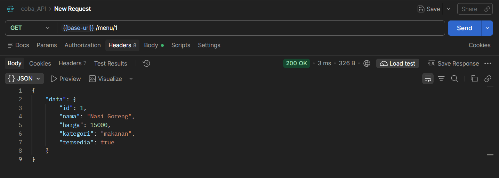

3. GET data menu berdasarkan kategori menggunakan query parameter.

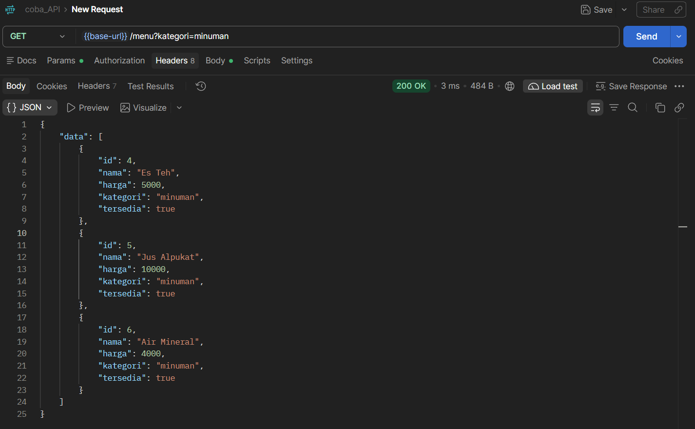

4. GET berdasarkan ID yang tidak ditemukan untuk memastikan sistem mengembalikan status 404.

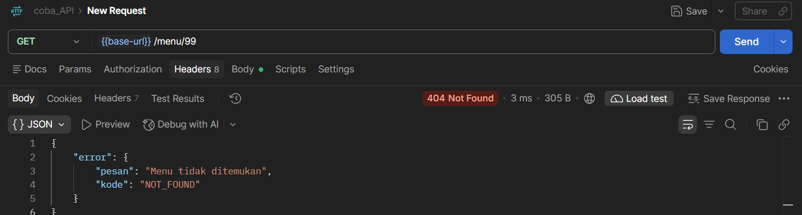

### 2. Pengujian POST

1. POST data menu dengan format yang benar untuk memastikan data berhasil ditambahkan dengan status 201.

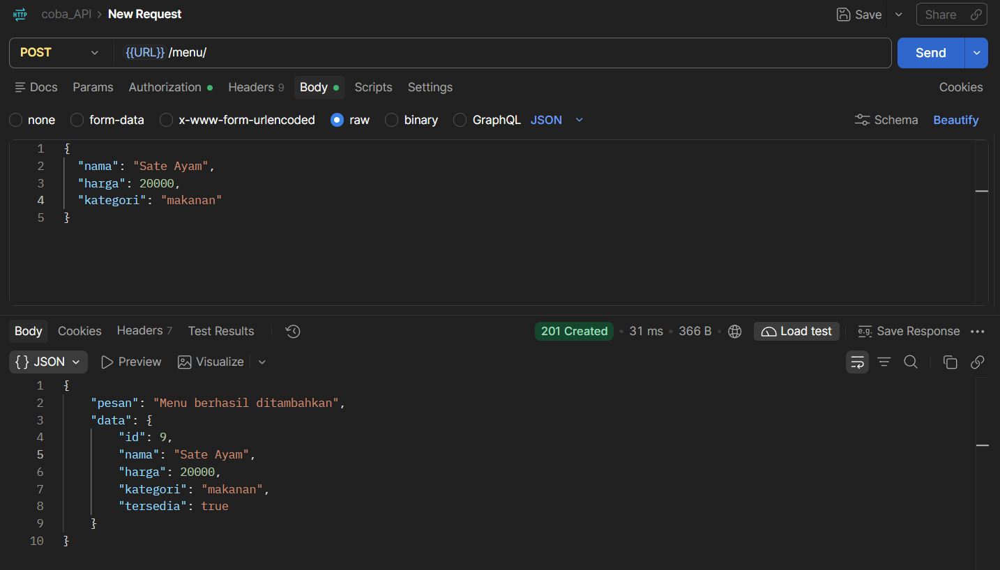

2. POST tanpa API Key atau menggunakan API Key yang salah untuk memastikan akses ditolak dengan status 401.

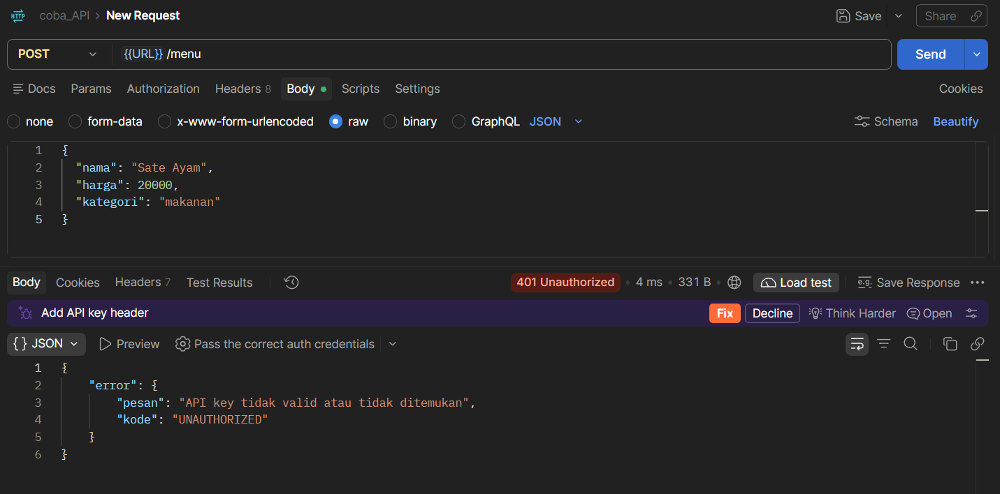

3. POST dengan format atau nilai input yang tidak sesuai aturan validasi untuk memastikan sistem mengembalikan status 422.

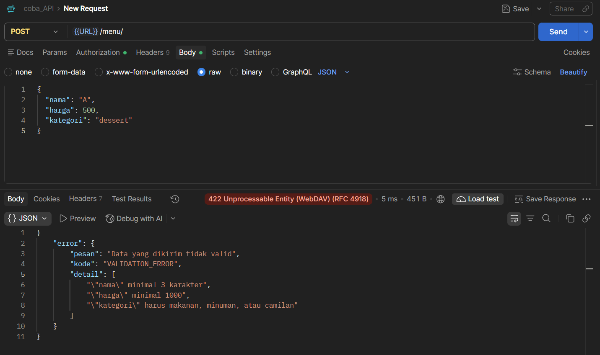

4. POST dengan nama menu yang sudah terdaftar untuk memastikan sistem menolak data duplikat dengan status 409.

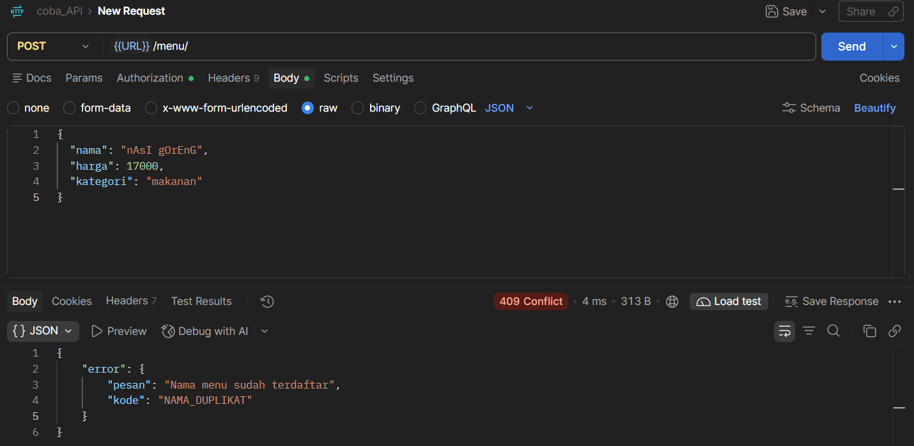

### 3. Pengujian PUT

1. PUT data menu berdasarkan ID untuk memperbarui informasi menu yang sudah tersedia.

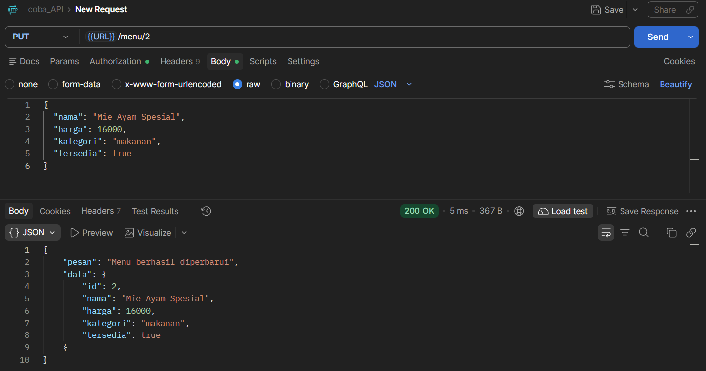

2. PUT dengan kondisi yang menghasilkan error untuk memastikan kesalahan pembaruan ditangani oleh error handler terpusat.

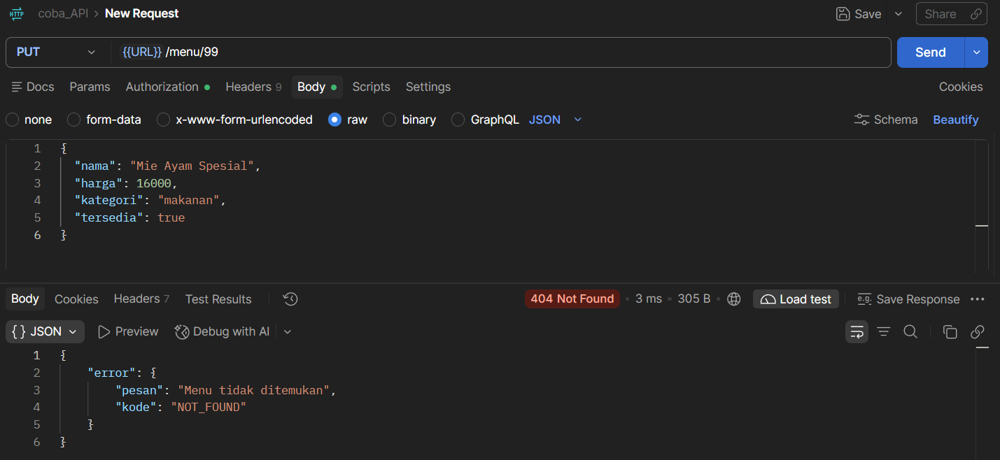

### 4. Pengujian DELETE

1. DELETE data menu berdasarkan ID untuk menghapus menu yang dipilih.

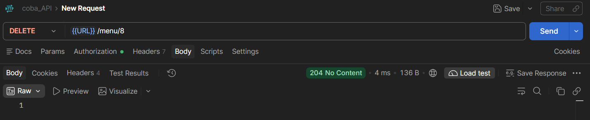

2. DELETE menggunakan ID yang tidak ditemukan untuk memastikan sistem mengembalikan status 404.

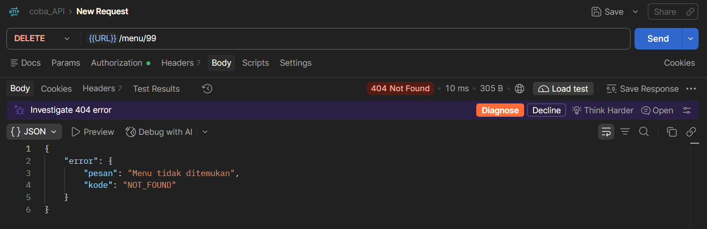

### 5. Pengujian Error Terpusat

1. Mengakses endpoint atau URL yang tidak tersedia untuk memastikan middleware `notFound` mengembalikan status 404 dengan kode `ROUTE_NOT_FOUND`.

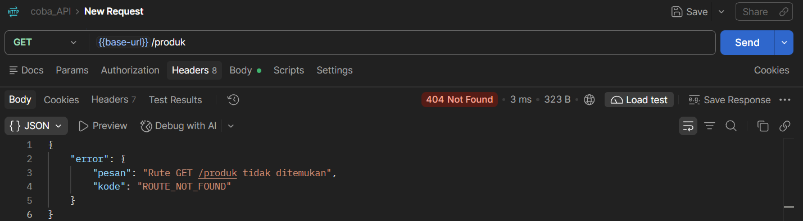

2. Menguji kesalahan internal server untuk memastikan middleware `errorHandler` menangani error dengan status 500 dan memberikan pesan kesalahan umum kepada klien.

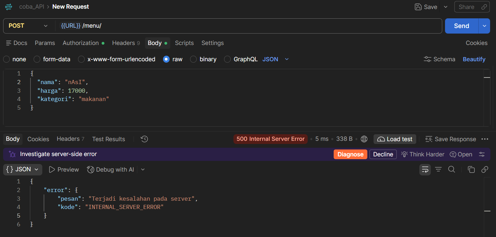

3. Menguji respons kesalahan API untuk memastikan format pesan dan kode error dikembalikan secara konsisten.


### 6. Pengujian REST Client dan Terminal

Pengujian tambahan dilakukan menggunakan REST Client pada Visual Studio Code melalui file `requests.http`. Pengujian ini digunakan untuk memastikan endpoint dapat dijalankan melalui HTTP request langsung dari editor.

Screenshot pengujian REST Client disimpan pada folder `screenshot/REST Client/`.

Pengujian terminal dilakukan untuk memastikan middleware `logger` berhasil mencatat metode request, URL, status response, dan waktu pemrosesan setiap request.

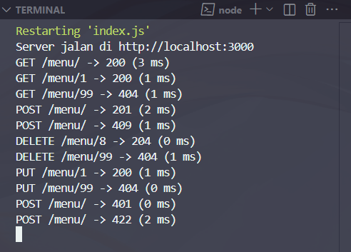

### Uji Error 500

Untuk menguji error 500 sesuai instruksi, ubah sementara `menu.push(item)` di `services/menu.service.js` menjadi `menu.dorong(item)`, lalu kirim request POST yang valid. Klien harus menerima HTTP 500 dengan pesan umum `Terjadi kesalahan pada server`, sedangkan detail stack tampil di terminal. Setelah pengujian, kembalikan menjadi `menu.push(item)` sebelum commit. Ambil screenshot sisi klien dan terminal.

## Deklarasi Penggunaan AI

| Bagian                                        | Alat AI | Dipakai untuk apa                                                        | Cara saya memeriksa hasilnya                                                |
| --------------------------------------------- | ------- | ------------------------------------------------------------------------ | --------------------------------------------------------------------------- |
| Struktur Express, router, controller, service | ChatGPT | Membantu menyusun pemisahan empat lapis dan endpoint                     | Menjalankan server dan menguji endpoint melalui Postman dan `requests.http` |
| Middleware dan error terpusat                 | ChatGPT | Membantu membuat logger, cekApiKey, notFound, AppError, dan errorHandler | Menguji status 401, 404, dan 500 serta memeriksa log terminal               |
| Skema Joi                                     | ChatGPT | Membantu menyusun aturan validasi field menu                             | Mengirim data tidak valid dan memastikan respons 422                        |

Pernyataan: Saya menggunakan ChatGPT sebagai alat bantu pada bagian-bagian yang tercantum di tabel. Saya memeriksa hasilnya dengan menjalankan aplikasi dan menguji endpoint melalui REST Client, serta memahami kembali fungsi setiap lapisan kode.

## Kesimpulan & Kendala

Penerapan middleware dan error terpusat membuat proses pencatatan request, pemeriksaan API key, validasi input, dan penanganan kesalahan menjadi lebih terstruktur. Sebelum error terpusat, penanganan status kesalahan berpotensi tersebar di setiap controller. Setelah menggunakan `AppError`, `notFound`, dan `errorHandler`, format respons kesalahan menjadi konsisten dan detail internal server tidak dibocorkan kepada klien.

Kendala yang mungkin muncul adalah urutan middleware yang keliru, API key yang tidak sesuai, atau validasi data yang gagal. Solusinya adalah memasang `notFound` dan `errorHandler` setelah seluruh rute, memastikan API key pada header `x-api-key`, dan menguji setiap kondisi menggunakan `requests.http`.
